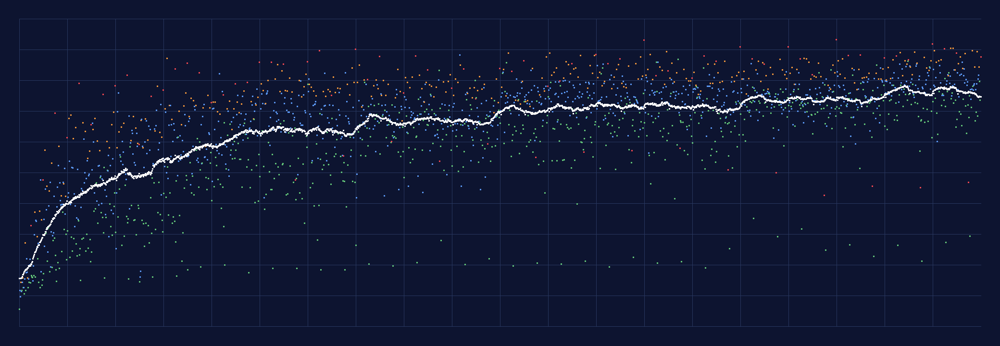

# Проверка уровней 1–2000

Сгенерировано утилитой `BottleSort/Levels/Build Database` (genVersion 2), сборка заняла 30,7 мин. Проверки — `LevelAudit` по `LEVEL_DESIGN.md` §9.5.

**Итог: 2000 из 2000 уровней прошли все проверки**, нарушений 0, предупреждений 136.

## Что проверяется
- решаемость: сохранённое решение проигрывается движком правил до победы, его длина = par;
- генератор нашёл кандидата, прошедшего все фильтры (§9.4.3: нет собранных и почти собранных бутылок, есть хороший стартовый ход, фишка участвует в решении, BW ≥ 0.6·RW для «?», жадный игрок укладывается в лимит ходов);
- тип уровня по расписанию §2.1, колба/фигурка/формы на месте, вместимость (4/5, колба 2U), не больше 14 бутылок;
- фишки не раньше своего уровня ввода, на уровне ввода фишка есть, число фишек по §3.2;
- уровни 1–30: RW ≥ 80 % (босс 25 — 60 %), OPT ≤ 20, нет тупика за первые 5 ходов (trap5);
- лимит ходов не строже порога 2★; нет дубликатов (с точностью до порядка бутылок и перестановки цветов) и почти дубликатов (> 30 % одинаковых бутылок с одним из 50 предыдущих);
- детерминизм: каждый 25-й уровень собран второй раз и совпал побайтно;
- предупреждения: средние уровни не проседают по окну 10, скачок DS между соседними обычными ≤ 25.

## Сводка по диапазонам (§3.1)

| Уровни | Шт. | Цвета ср. | 5 слоёв | Бутылок ср. | OPT ср. | Точный OPT | RW ср. | GW ср. | DS ср. | DS E / M / H / B | С «?» | С фишками | Чистые обычные |
|---|---|---|---|---|---|---|---|---|---|---|---|---|---|
| 1–3 | 3 | 3,0 | 0 % | 5,0 | 6,3 | 100 % | 100 % | 100 % | 9,1 | 6 / 11 / — / — | 0 % | 0 % | — |
| 4–10 | 7 | 4,3 | 0 % | 6,3 | 12,3 | 100 % | 99 % | 99 % | 13,4 | 12 / 13 / 15 / — | 0 % | 0 % | 100 % |
| 11–20 | 10 | 4,7 | 0 % | 6,7 | 13,7 | 100 % | 94 % | 95 % | 16,7 | 12 / 18 / 22 / — | 0 % | 0 % | 100 % |
| 21–30 | 10 | 5,2 | 0 % | 7,2 | 15,1 | 100 % | 94 % | 92 % | 18,7 | 15 / 19 / — / 33 | 0 % | 0 % | 100 % |
| 31–50 | 20 | 5,7 | 0 % | 7,7 | 16,5 | 100 % | 78 % | 78 % | 27,1 | 16 / 30 / 35 / 48 | 0 % | 0 % | 100 % |
| 51–75 | 25 | 6,3 | 0 % | 8,3 | 19,0 | 100 % | 68 % | 66 % | 34,9 | 24 / 34 / 50 / 69 | 0 % | 0 % | 100 % |
| 76–100 | 25 | 6,7 | 0 % | 8,7 | 20,0 | 100 % | 65 % | 65 % | 37,3 | 24 / 44 / 48 / 61 | 0 % | 0 % | 100 % |
| 101–150 | 50 | 6,9 | 0 % | 8,9 | 20,7 | 100 % | 56 % | 54 % | 42,5 | 26 / 46 / 63 / 72 | 34 % | 34 % | 59 % |
| 151–200 | 50 | 7,3 | 0 % | 9,3 | 21,4 | 100 % | 47 % | 48 % | 47,2 | 37 / 47 / 63 / 77 | 22 % | 36 % | 56 % |
| 201–250 | 50 | 7,7 | 0 % | 9,7 | 22,6 | 100 % | 44 % | 42 % | 50,6 | 37 / 55 / 63 / 71 | 28 % | 46 % | 44 % |
| 251–300 | 50 | 7,7 | 0 % | 9,7 | 22,9 | 100 % | 42 % | 45 % | 50,0 | 34 / 56 / 65 / 76 | 16 % | 34 % | 59 % |
| 301–350 | 50 | 7,9 | 0 % | 10,0 | 24,3 | 100 % | 36 % | 35 % | 55,3 | 39 / 60 / 73 / 85 | 26 % | 44 % | 46 % |
| 351–400 | 50 | 8,2 | 6 % | 10,2 | 24,8 | 100 % | 31 % | 33 % | 58,0 | 48 / 60 / 71 / 78 | 14 % | 40 % | 49 % |
| 401–450 | 50 | 8,2 | 4 % | 10,2 | 24,8 | 100 % | 30 % | 30 % | 59,5 | 50 / 62 / 71 / 77 | 18 % | 48 % | 41 % |
| 451–500 | 50 | 8,7 | 4 % | 10,7 | 26,9 | 100 % | 24 % | 22 % | 63,5 | 52 / 68 / 72 / 83 | 32 % | 52 % | 36 % |
| 501–700 | 200 | 8,7 | 9 % | 10,7 | 26,8 | 100 % | 24 % | 24 % | 63,8 | 51 / 68 / 78 / 77 | 27 % | 48 % | 43 % |
| 701–1000 | 300 | 9,0 | 9 % | 11,0 | 28,2 | 100 % | 19 % | 20 % | 66,8 | 61 / 66 / 78 / 76 | 27 % | 45 % | 46 % |
| 1001–1100 | 100 | 9,5 | 6 % | 11,5 | 29,8 | 100 % | 14 % | 14 % | 70,5 | 62 / 74 / 78 / 76 | 32 % | 53 % | 36 % |
| 1101–1500 | 400 | 9,6 | 12 % | 11,6 | 30,6 | 100 % | 13 % | 14 % | 71,5 | 62 / 74 / 82 / 78 | 33 % | 53 % | 36 % |
| 1501–1800 | 300 | 9,9 | 9 % | 11,9 | 31,4 | 99 % | 10 % | 10 % | 73,9 | 69 / 74 / 82 / 77 | 31 % | 53 % | 35 % |
| 1801–2000 | 200 | 10,6 | 10 % | 12,6 | 33,8 | 100 % | 7 % | 7 % | 76,7 | 69 / 79 / 86 / 78 | 36 % | 53 % | 37 % |

## По главам

| Глава | Уровни | DS ср. | DS мин–макс | DS босса главы | RW ср. | OPT ср. |
|---|---|---|---|---|---|---|
| 1 | 1–50 | 20,3 | 6–48 | 48 | 89 % | 14,5 |
| 2 | 51–100 | 36,1 | 15–69 | 61 | 66 % | 19,5 |
| 3 | 101–150 | 42,5 | 15–79 | 66 | 56 % | 20,7 |
| 4 | 151–200 | 47,2 | 16–78 | 78 | 47 % | 21,4 |
| 5 | 201–250 | 50,6 | 16–82 | 59 | 44 % | 22,6 |
| 6 | 251–300 | 50,0 | 15–78 | 77 | 42 % | 22,9 |
| 7 | 301–350 | 55,3 | 16–87 | 86 | 36 % | 24,3 |
| 8 | 351–400 | 58,0 | 19–83 | 73 | 31 % | 24,8 |
| 9 | 401–450 | 59,5 | 20–82 | 79 | 30 % | 24,8 |
| 10 | 451–500 | 63,5 | 18–86 | 86 | 24 % | 26,9 |
| 11 | 501–600 | 63,8 | 19–86 | 86 | 25 % | 27,1 |
| 12 | 601–700 | 63,7 | 18–90 | 90 | 23 % | 26,6 |
| 13 | 701–800 | 66,7 | 20–88 | 76 | 19 % | 28,3 |
| 14 | 801–900 | 67,2 | 21–88 | 78 | 19 % | 28,4 |
| 15 | 901–1000 | 66,6 | 20–88 | 84 | 20 % | 28,0 |
| 16 | 1001–1100 | 70,5 | 20–89 | 78 | 14 % | 29,8 |
| 17 | 1101–1200 | 71,4 | 20–89 | 88 | 13 % | 30,9 |
| 18 | 1201–1300 | 72,0 | 20–93 | 93 | 13 % | 30,4 |
| 19 | 1301–1400 | 71,6 | 21–89 | 81 | 13 % | 30,8 |
| 20 | 1401–1500 | 71,1 | 19–91 | 91 | 14 % | 30,5 |
| 21 | 1501–1600 | 73,9 | 29–91 | 91 | 10 % | 31,5 |
| 22 | 1601–1700 | 73,9 | 25–93 | 93 | 10 % | 31,3 |
| 23 | 1701–1800 | 73,9 | 23–88 | 87 | 10 % | 31,6 |
| 24 | 1801–1900 | 76,4 | 21–92 | 92 | 8 % | 33,9 |
| 25 | 1901–2000 | 76,9 | 27–91 | 88 | 7 % | 33,7 |

## Типы уровней

| Тип | Шт. | DS ср. | OPT ср. | RW ср. |
|---|---|---|---|---|
| Normal | 1566 | 65,1 | 27,6 | 22 % |
| Special | 158 | 63,2 | 28,6 | 23 % |
| BigFlask | 157 | 71,4 | 32,4 | 12 % |
| Rescue | 39 | 21,6 | 27,6 | 95 % |
| Boss | 55 | 74,1 | 31,0 | 14 % |
| ChapterBoss | 25 | 80,4 | 32,0 | 6 % |

## Кривая сложности

Точки — DS каждого уровня (цвет по тиру: E зелёный, M синий, H оранжевый, B красный), линия — скользящее среднее по 50. Все числа по уровням — в `levels_curve.csv`.

| Уровни | DS E | DS M | DS H | DS B | H − E |
|---|---|---|---|---|---|
| 1–250 | 27,8 | 41,5 | 52,9 | 65,1 | 25,1 |
| 251–500 | 44,5 | 60,9 | 70,2 | 79,7 | 25,7 |
| 501–750 | 52,7 | 67,8 | 78,3 | 78,4 | 25,6 |
| 751–1000 | 61,5 | 66,4 | 77,7 | 74,1 | 16,1 |
| 1001–1250 | 61,6 | 74,6 | 81,0 | 78,6 | 19,4 |
| 1251–1500 | 63,0 | 74,1 | 81,9 | 77,1 | 18,8 |
| 1501–1750 | 69,1 | 74,0 | 82,4 | 79,5 | 13,4 |
| 1751–2000 | 69,6 | 78,4 | 85,0 | 75,9 | 15,4 |

## Генерация на устройстве

| Случай | мс |
|---|---|
| обычный, 2001+ — среднее | 151 |
| обычный, 2001+ — худший | 313 |
| особый (смесь форм, бывает 5 слоёв) — среднее | 138 |
| особый (смесь форм, бывает 5 слоёв) — худший | 195 |
| большая колба — среднее | 363 |
| большая колба — худший | 491 |
| спасение — среднее | 287 |
| спасение — худший | 529 |
| босс «испытание цветом» (12 цветов) — среднее | 273 |
| босс «испытание цветом» (12 цветов) — худший | 420 |
| босс «ловушка» — среднее | 92 |
| босс «ловушка» — худший | 181 |
| босс с лимитом ходов (нужны метрики) — среднее | 134 |
| босс с лимитом ходов (нужны метрики) — худший | 198 |
| босс главы (3 фишки, формы) — среднее | 94 |
| босс главы (3 фишки, формы) — худший | 207 |

Замер — в редакторе Unity (Mono, один поток). На телефоне 2020+ с IL2CPP ждём примерно ×1.5–3 медленнее. Поэтому уровни 1–2000 не генерируются на устройстве, а берутся из готовой базы `Assets/_Game/Levels/Resources/LevelDatabase.txt`: отбор по сложности требует метрик по 16 кандидатам, это секунды на уровень. Уровни 2001+ строятся на лету в фоне (`LevelLoader`, `Task.Run`), следующий уровень готовится заранее, пока игрок смотрит на экран победы, и кешируется.

## Решения и отступления от LEVEL_DESIGN

- **Песочные часы (§5.9).** При двух пустых переворот ни разу не сократил решение (240 случайных раскладок), так что фильтр «OPT с переворотом короче хотя бы на 2» был невыполним. Часы ставятся с одной пустой бутылкой и не больше чем на 7 цветах: без переворота такие уровни обычно не решаются, то есть фишка действительно нужна. В комбо с другими фишками часы не ставятся: одна пустая плюс ещё фишка почти всегда нерешаемо.
- **Лимит ходов (§5.8).** Требование «жадный игрок укладывается в лимит в 40 % попыток» выполнимо только до 8 цветов: при 9 жадный игрок укладывается в 16 % случаев. Поэтому боссы с лимитом (L mod 100 = 75 с L501) — 4 слоя и не больше 8 цветов, сложность им даёт сам лимит. Обучающий L501: лимит par + 15, но не строже порога 2★ (§4: с лимитом любая победа — минимум две звезды).
- **Мягкая форма замка и тонировки** (третья пустая: L151, L251–253). Такой фишке разрешено не участвовать в оптимальном решении — она облегчает уровень, а не мешает.
- **5 слоёв.** В обычных уровнях выключены до решения заказчика (`LevelParams.FiveLayersInNormalLevels`, §10 п. 10). 5 слоёв есть в особых уровнях (с 351, половина), в колбах (с 451, половина) и у боссов (с 501, по доле диапазона). L351 по расписанию §2.1 — обычный уровень, поэтому 5 слоёв вводятся на обычном, а не на особом.
- **Боссы «испытание цветом»** ограничены 12 цветами и 14 бутылками: C_H + 1 на 1801+ дало бы 13 цветов. «Ловушка» с замком на пустой — только при 4 слоях и не больше 8 цветах; иначе лёд на пустой.
- **Доли фишек (§3.1–3.2).** Сначала решается, будет ли обычный уровень «чистым» (доля §3.2), иначе ставятся «?» с долей из таблицы §3.1 и 1–2 механики по весам. Итоговые доли — в колонках «С «?»» и «С фишками».
- **Тиры (§2.3).** Вместо калибровочной выборки из 2000 раскладок на конфигурацию берётся место по DS среди 16 кандидатов самого уровня, прошедших фильтры: E — 28 %, M — 50 %, H — 72 %, босс — 93 %, L2000 — 40 % (финал — праздник, а не стена, §5.13).
- **Пила против скачков.** §2.3 одновременно хочет H на 65–90 процентиле, E на 10–35 и скачок DS между соседними обычными уровнями не больше 25. В одной конфигурации E и H расходятся на 20–30 DS, поэтому скачки H ↔ E оставлены предупреждениями: это и есть пила.
- **Хороший стартовый ход (GOOD0).** На старте все бутылки полные, налить «на свой цвет» некуда. Хорошим считается и перенос отрезка из двух и больше слоёв в пустую.
- **trap5** считается по первым пяти позициям оптимального пути: есть ли ход в доказанный тупик. NARROW не считается — это сотни решений солвера на уровень, а в DS он не входит.
- **Спасения (§2.4).** Фигурка — бутылка с рецептом: принимает только следующий цвет рецепта и ничего не отдаёт; рецепт из U слоёв одного цвета, с L328 — 2U из двух цветов. Своего арта у фигурок пока нет, на поле рисуется classic (задача vfx-art).
- **Почти дубликаты.** Уровень, у которого больше 30 % бутылок совпали с одним из 50 предыдущих, пересобирается с другим seed по порядку номеров; номер пересборки хранится в базе (`rt`).
- **Не сделано:** тонированная колба (1201), цепочка замков (1301), колба во льду (1401) — для них нужны новые правила. В этих главах стоят обычные фишки по таблице.

## Нарушения

Нет.

## Предупреждения

- **скачок** — 136: L54, L56, L64, L69, L82, L84, L106, L108, L109, L112, L114, L118, L119, L122, L134, L139, L144, L148, L152, L156, L159, L164, L187, L188, L193, L194, L197, L198, L207, L214, L216, L219, L229, L239, L244, L246, L254, L256, L262, L264, …
