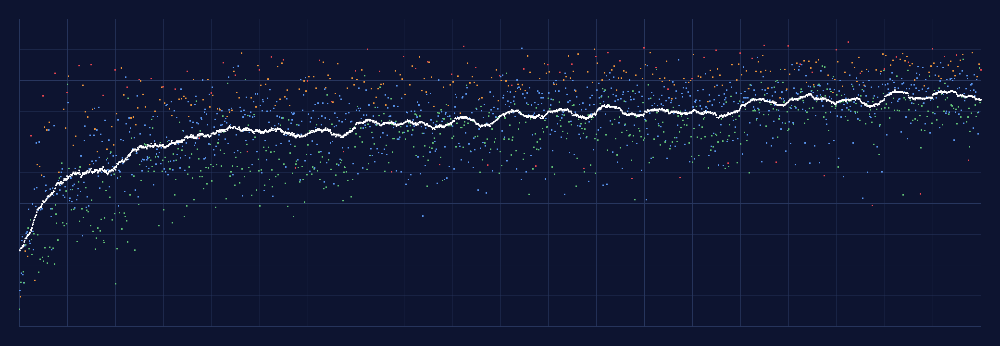

# Проверка уровней 1–2000

Сгенерировано утилитой `BottleSort/Levels/Build Database` (genVersion 3), сборка заняла 6,1 мин. Проверки — `LevelAudit` по `LEVEL_DESIGN.md` §9.5.

**Итог: 2000 из 2000 уровней прошли все проверки**, нарушений 0, предупреждений 107.

## Что проверяется
- решаемость: сохранённое решение проигрывается движком правил до победы, его длина = par;
- генератор нашёл кандидата, прошедшего все фильтры (§9.4.3: нет собранных и почти собранных бутылок, есть хороший стартовый ход, фишка участвует в решении, BW ≥ 0.6·RW для «?», жадный игрок укладывается в лимит ходов);
- тип уровня по расписанию §2.1, колба/фигурка/формы на месте, вместимость (4/5, колба 2U), не больше 14 бутылок;
- фишки не раньше своего уровня ввода, на уровне ввода фишка есть, число фишек по §3.2;
- уровни 4–30 (§3.3): 4–10 — RW ≥ 50 %, OPT ≤ 22; 11–30 — RW ≥ 35 % (босс 25 — 25 %), OPT ≤ 26; нет тупика за первые 5 ходов (trap5);
- лимит ходов не строже порога 2★; нет дубликатов (с точностью до порядка бутылок и перестановки цветов) и почти дубликатов (> 30 % одинаковых бутылок с одним из 50 предыдущих);
- детерминизм: каждый 25-й уровень собран второй раз и совпал побайтно;
- предупреждения: средние уровни не проседают по окну 10, скачок DS между соседними обычными ≤ 25.

## Сводка по диапазонам (§3.1)

| Уровни | Шт. | Цвета ср. | 5 слоёв | Бутылок ср. | OPT ср. | Точный OPT | RW ср. | GW ср. | DS ср. | DS E / M / H / B | С «?» | С фишками | Чистые обычные |
|---|---|---|---|---|---|---|---|---|---|---|---|---|---|
| 1–3 | 3 | 3,0 | 0 % | 5,0 | 6,3 | 100 % | 100 % | 100 % | 9,1 | 6 / 12 / 10 / — | 0 % | 0 % | — |
| 4–10 | 7 | 5,3 | 0 % | 7,3 | 15,6 | 100 % | 91 % | 89 % | 19,8 | 16 / 21 / — / — | 71 % | 71 % | 17 % |
| 11–20 | 10 | 5,8 | 0 % | 7,9 | 16,3 | 100 % | 79 % | 77 % | 27,5 | 24 / 31 / 24 / — | 10 % | 70 % | 22 % |
| 21–30 | 10 | 6,1 | 0 % | 8,1 | 17,0 | 100 % | 70 % | 70 % | 32,5 | 28 / 30 / — / 62 | 60 % | 90 % | 0 % |
| 31–50 | 20 | 6,7 | 0 % | 8,8 | 19,8 | 100 % | 58 % | 62 % | 40,2 | 26 / 45 / 42 / 75 | 30 % | 55 % | 33 % |
| 51–75 | 25 | 6,9 | 0 % | 8,9 | 20,8 | 92 % | 56 % | 54 % | 42,6 | 25 / 45 / 65 / 82 | 24 % | 48 % | 37 % |
| 76–100 | 25 | 7,2 | 0 % | 9,2 | 21,3 | 96 % | 49 % | 48 % | 46,2 | 38 / 46 / 62 / 76 | 32 % | 60 % | 32 % |
| 101–150 | 50 | 7,2 | 0 % | 9,2 | 21,8 | 94 % | 44 % | 47 % | 50,3 | 43 / 47 / 67 / 85 | 38 % | 60 % | 32 % |
| 151–200 | 50 | 7,8 | 0 % | 9,8 | 24,0 | 92 % | 43 % | 44 % | 51,2 | 38 / 56 / 62 / 79 | 46 % | 62 % | 37 % |
| 201–250 | 50 | 7,9 | 6 % | 9,8 | 24,3 | 92 % | 38 % | 40 % | 54,6 | 40 / 57 / 72 / 79 | 46 % | 64 % | 30 % |
| 251–300 | 50 | 8,3 | 6 % | 10,3 | 25,5 | 92 % | 29 % | 32 % | 59,1 | 54 / 57 / 75 / 79 | 32 % | 50 % | 47 % |
| 301–350 | 50 | 8,3 | 8 % | 10,3 | 25,8 | 92 % | 29 % | 31 % | 59,6 | 51 / 60 / 73 / 80 | 46 % | 62 % | 35 % |
| 351–400 | 50 | 8,6 | 10 % | 10,6 | 26,9 | 94 % | 25 % | 30 % | 62,4 | 53 / 66 / 74 / 69 | 32 % | 56 % | 45 % |
| 401–450 | 50 | 8,5 | 14 % | 10,5 | 27,8 | 92 % | 24 % | 25 % | 63,8 | 54 / 66 / 73 / 84 | 40 % | 58 % | 35 % |
| 451–500 | 50 | 8,6 | 6 % | 10,5 | 26,7 | 92 % | 21 % | 25 % | 64,3 | 56 / 66 / 78 / 70 | 46 % | 70 % | 24 % |
| 501–700 | 200 | 8,7 | 9 % | 10,7 | 27,3 | 92 % | 24 % | 26 % | 63,0 | 53 / 65 / 79 / 76 | 44 % | 61 % | 37 % |
| 701–1000 | 300 | 9,1 | 9 % | 11,1 | 28,7 | 93 % | 19 % | 22 % | 66,3 | 63 / 64 / 79 / 77 | 39 % | 59 % | 39 % |
| 1001–1100 | 100 | 9,5 | 6 % | 11,5 | 30,0 | 93 % | 15 % | 17 % | 69,1 | 62 / 70 / 80 / 75 | 44 % | 67 % | 29 % |
| 1101–1500 | 400 | 9,6 | 12 % | 11,6 | 30,7 | 93 % | 15 % | 17 % | 69,8 | 64 / 70 / 82 / 77 | 49 % | 67 % | 30 % |
| 1501–1800 | 300 | 10,0 | 9 % | 11,9 | 31,9 | 92 % | 10 % | 12 % | 73,3 | 71 / 72 / 83 / 77 | 43 % | 66 % | 29 % |
| 1801–2000 | 200 | 10,6 | 10 % | 12,6 | 34,1 | 92 % | 7 % | 9 % | 75,5 | 71 / 76 / 85 / 78 | 43 % | 61 % | 36 % |

## По главам

| Глава | Уровни | DS ср. | DS мин–макс | DS босса главы | RW ср. | OPT ср. |
|---|---|---|---|---|---|---|
| 1 | 1–50 | 31,4 | 6–75 | 75 | 72 % | 17,1 |
| 2 | 51–100 | 44,4 | 20–82 | 76 | 53 % | 21,1 |
| 3 | 101–150 | 50,3 | 28–85 | 85 | 44 % | 21,8 |
| 4 | 151–200 | 51,2 | 25–84 | 84 | 43 % | 24,0 |
| 5 | 201–250 | 54,6 | 14–84 | 80 | 38 % | 24,3 |
| 6 | 251–300 | 59,1 | 33–81 | 78 | 29 % | 25,5 |
| 7 | 301–350 | 59,6 | 34–83 | 83 | 29 % | 25,8 |
| 8 | 351–400 | 62,4 | 41–80 | 76 | 25 % | 26,9 |
| 9 | 401–450 | 63,8 | 39–86 | 82 | 24 % | 27,8 |
| 10 | 451–500 | 64,3 | 43–89 | 84 | 21 % | 26,7 |
| 11 | 501–600 | 62,9 | 36–88 | 80 | 24 % | 27,2 |
| 12 | 601–700 | 63,0 | 41–87 | 83 | 24 % | 27,4 |
| 13 | 701–800 | 66,8 | 50–90 | 88 | 18 % | 28,6 |
| 14 | 801–900 | 65,6 | 36–88 | 82 | 20 % | 28,7 |
| 15 | 901–1000 | 66,7 | 43–91 | 82 | 18 % | 28,8 |
| 16 | 1001–1100 | 69,1 | 43–91 | 85 | 15 % | 30,0 |
| 17 | 1101–1200 | 69,2 | 43–90 | 88 | 16 % | 30,8 |
| 18 | 1201–1300 | 70,5 | 41–91 | 91 | 13 % | 30,8 |
| 19 | 1301–1400 | 69,9 | 41–89 | 81 | 15 % | 30,5 |
| 20 | 1401–1500 | 69,4 | 51–90 | 89 | 14 % | 30,7 |
| 21 | 1501–1600 | 73,0 | 50–92 | 91 | 10 % | 32,1 |
| 22 | 1601–1700 | 74,3 | 49–90 | 90 | 9 % | 31,8 |
| 23 | 1701–1800 | 72,7 | 39–93 | 84 | 10 % | 31,9 |
| 24 | 1801–1900 | 75,3 | 43–90 | 90 | 7 % | 34,3 |
| 25 | 1901–2000 | 75,6 | 54–89 | 84 | 7 % | 34,0 |

## Типы уровней

| Тип | Шт. | DS ср. | OPT ср. | RW ср. |
|---|---|---|---|---|
| Normal | 1503 | 66,3 | 27,8 | 20 % |
| Special | 158 | 65,4 | 28,9 | 20 % |
| BigFlask | 159 | 55,0 | 39,2 | 31 % |
| Rescue | 100 | 66,1 | 27,5 | 21 % |
| Boss | 55 | 74,0 | 31,0 | 15 % |
| ChapterBoss | 25 | 83,6 | 32,5 | 2 % |

## Кривая сложности

Точки — DS каждого уровня (цвет по тиру: E зелёный, M синий, H оранжевый, B красный), линия — скользящее среднее по 50. Все числа по уровням — в `levels_curve.csv`.

| Уровни | DS E | DS M | DS H | DS B | H − E |
|---|---|---|---|---|---|
| 1–250 | 35,4 | 47,8 | 59,2 | 78,3 | 23,8 |
| 251–500 | 53,8 | 63,0 | 74,5 | 76,4 | 20,7 |
| 501–750 | 55,1 | 64,6 | 78,6 | 77,9 | 23,5 |
| 751–1000 | 63,4 | 64,1 | 78,9 | 75,3 | 15,6 |
| 1001–1250 | 63,9 | 69,8 | 81,6 | 78,3 | 17,7 |
| 1251–1500 | 63,9 | 69,9 | 81,6 | 74,9 | 17,8 |
| 1501–1750 | 71,7 | 72,0 | 82,6 | 80,6 | 10,8 |
| 1751–2000 | 71,0 | 74,8 | 84,6 | 74,5 | 13,6 |

## Генерация на устройстве

| Случай | мс |
|---|---|
| обычный, 2001+ — среднее | 67 |
| обычный, 2001+ — худший | 120 |
| особый (смесь форм, бывает 5 слоёв) — среднее | 77 |
| особый (смесь форм, бывает 5 слоёв) — худший | 178 |
| большая колба — среднее | 90 |
| большая колба — худший | 173 |
| спасение — среднее | 47 |
| спасение — худший | 81 |
| босс «испытание цветом» (12 цветов) — среднее | 209 |
| босс «испытание цветом» (12 цветов) — худший | 388 |
| босс «ловушка» — среднее | 159 |
| босс «ловушка» — худший | 242 |
| босс с лимитом ходов (нужны метрики) — среднее | 63 |
| босс с лимитом ходов (нужны метрики) — худший | 92 |
| босс главы (3 фишки, формы) — среднее | 216 |
| босс главы (3 фишки, формы) — худший | 373 |

Замер — в редакторе Unity (Mono, один поток). На телефоне 2020+ с IL2CPP ждём примерно ×1.5–3 медленнее. Поэтому уровни 1–2000 не генерируются на устройстве, а берутся из готовой базы `Assets/_Game/Levels/Resources/LevelDatabase.txt`: отбор по сложности требует метрик по 16 кандидатам, это секунды на уровень. Уровни 2001+ строятся на лету в фоне (`LevelLoader`, `Task.Run`), следующий уровень готовится заранее, пока игрок смотрит на экран победы, и кешируется.

## Решения и отступления от LEVEL_DESIGN

- **Песочные часы (§5.9).** При двух пустых переворот ни разу не сократил решение (240 случайных раскладок), так что фильтр «OPT с переворотом короче хотя бы на 2» был невыполним. Часы ставятся с одной пустой бутылкой и не больше чем на 7 цветах: без переворота такие уровни обычно не решаются, то есть фишка действительно нужна. В комбо с другими фишками часы не ставятся: одна пустая плюс ещё фишка почти всегда нерешаемо.
- **Лимит ходов (§5.8).** Требование «жадный игрок укладывается в лимит в 40 % попыток» выполнимо только до 8 цветов: при 9 жадный игрок укладывается в 16 % случаев. Поэтому боссы с лимитом (L mod 100 = 75 с L501) — 4 слоя и не больше 8 цветов, сложность им даёт сам лимит. Обучающий L501: лимит par + 15, но не строже порога 2★ (§4: с лимитом любая победа — минимум две звезды).
- **Мягкая форма замка и тонировки** (третья пустая: L151, L251–253). Такой фишке разрешено не участвовать в оптимальном решении — она облегчает уровень, а не мешает.
- **5 слоёв.** В обычных уровнях выключены до решения заказчика (`LevelParams.FiveLayersInNormalLevels`, §10 п. 10). 5 слоёв есть в особых уровнях (с 351, половина), в колбах (с 451, половина) и у боссов (с 501, по доле диапазона). L351 по расписанию §2.1 — обычный уровень, поэтому 5 слоёв вводятся на обычном, а не на особом.
- **Боссы «испытание цветом»** ограничены 12 цветами и 14 бутылками: C_H + 1 на 1801+ дало бы 13 цветов. «Ловушка» с замком на пустой — только при 4 слоях и не больше 8 цветах; иначе лёд на пустой.
- **Доли фишек (§3.1–3.2).** Сначала решается, будет ли обычный уровень «чистым» (доля §3.2), иначе ставятся «?» с долей из таблицы §3.1 и 1–2 механики по весам. Итоговые доли — в колонках «С «?»» и «С фишками».
- **Тиры (§2.3).** Вместо калибровочной выборки из 2000 раскладок на конфигурацию берётся место по DS среди 16 кандидатов самого уровня, прошедших фильтры: E — 28 %, M — 50 %, H — 72 %, босс — 93 %, L2000 — 40 % (финал — праздник, а не стена, §5.13).
- **Пила против скачков.** §2.3 одновременно хочет H на 65–90 процентиле, E на 10–35 и скачок DS между соседними обычными уровнями не больше 25. В одной конфигурации E и H расходятся на 20–30 DS, поэтому скачки H ↔ E оставлены предупреждениями: это и есть пила.
- **Хороший стартовый ход (GOOD0).** На старте все бутылки полные, налить «на свой цвет» некуда. Хорошим считается и перенос отрезка из двух и больше слоёв в пустую.
- **trap5** считается по первым пяти позициям оптимального пути: есть ли ход в доказанный тупик. NARROW не считается — это сотни решений солвера на уровень, а в DS он не входит.
- **Спасения (§2.4).** Фигурка — бутылка с рецептом: принимает только следующий цвет рецепта и ничего не отдаёт; рецепт из U слоёв одного цвета, с L328 — 2U из двух цветов. Своего арта у фигурок пока нет, на поле рисуется classic (задача vfx-art).
- **Почти дубликаты.** Уровень, у которого больше 30 % бутылок совпали с одним из 50 предыдущих, пересобирается с другим seed по порядку номеров; номер пересборки хранится в базе (`rt`).
- **Не сделано:** тонированная колба (1201), цепочка замков (1301), колба во льду (1401) — для них нужны новые правила. В этих главах стоят обычные фишки по таблице.

## Нарушения

Нет.

## Предупреждения

- **скачок** — 107: L33, L42, L44, L49, L52, L54, L59, L62, L64, L74, L93, L94, L104, L133, L134, L136, L143, L144, L154, L156, L159, L162, L166, L179, L194, L202, L204, L206, L207, L214, L219, L222, L224, L227, L231, L249, L254, L298, L319, L324, …
